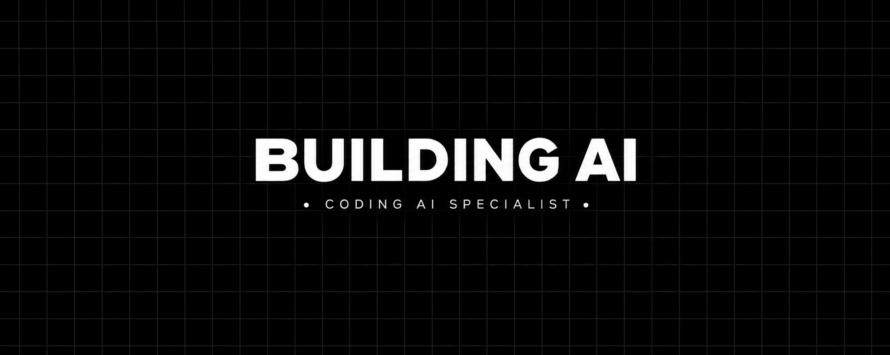

 
<h1 align="center">Hey  I'm Ali Siddiqui</h1>
<h3 align="center">Developer | SaaS Builder | Entrepreneur 🚀</h3>
                     
## 📌 About Me

- I'm passionate about building useful digital products, exploring technology, and turning ideas into reality.

## 💻 What I'm Working On

<table align="center">
  <tr>
    <td align="center" width="33%">
      
      <h3>🎬 Caption Studio</h3>
      Building caption creation tools.
        
      <a href="#" style="color: white;">Explore Project →</a>
    </td>
    <td align="center" width="33%">
      
      <h3>⚡ PeakCut</h3>
      Exploring automated video clipping workflows.
        
      <a href="#" style="color: white;">Explore Project →</a>
    </td>
    <td align="center" width="33%">
      
      <h3>🚀 SaaS</h3>
      Learning, building, and experimenting with SaaS products.
        
      <a href="#" style="color: white;">Explore Project →</a>
    </td>
  </tr>
</table>

## 🛠️ Interests

      

## 🎯 My Goal

- Build products that solve real problems and create meaningful impact.

## ⭐ Featured Projects

A collection of things I've built and experimented with.

<!-- Add your completed projects here -->

## 🛠️ Tech Stack

- Technologies and tools I work with.

<h3 align="left">Languages and Tools:</h3>

               

## 🧠 Currently Learning

- Building scalable SaaS products

- AI-powered applications

- Product development and automation

- Improving software engineering skills

## 🎯 My Vision

- Build useful products, solve real-world problems, and turn ambitious ideas into reality.

## 🤝 Let's Connect

  <b>BUILD. CREATE. SHIP. REPEAT. 🚀</b>

<picture>
  <source media="(prefers-color-scheme: dark)" srcset="https://raw.githubusercontent.com/tobiasmeyhoefer/tobiasmeyhoefer/output/github-snake-dark.svg" />
  <source media="(prefers-color-scheme: light)" srcset="https://raw.githubusercontent.com/tobiasmeyhoefer/tobiasmeyhoefer/output/github-snake.svg" />
  
</picture>

